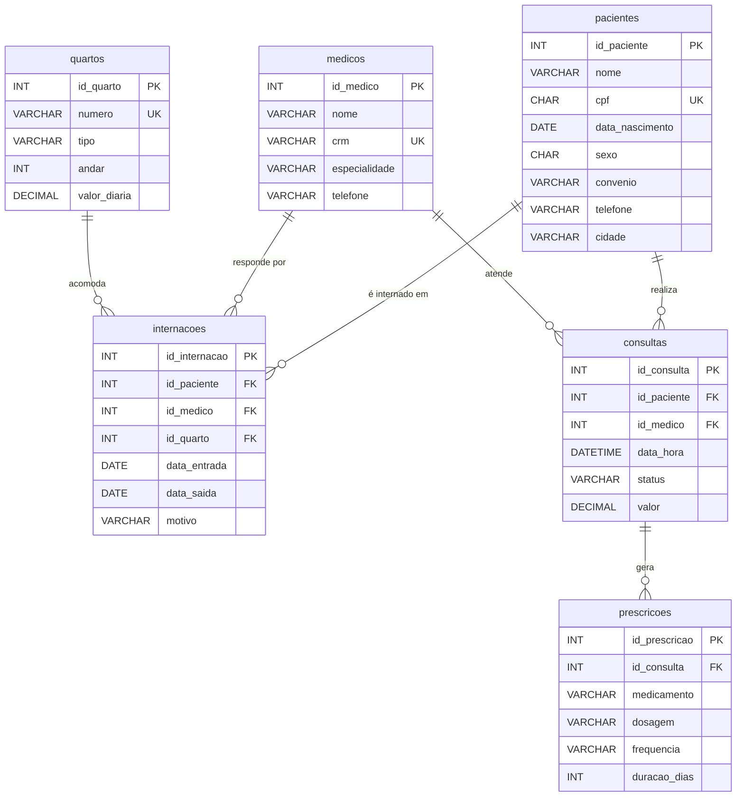

# Hospital Geral Vida & Saúde — Banco de Dados `hospital_db`

Trabalho da disciplina de Banco de Dados (MySQL), com foco em **DDL** (criação da estrutura) e **DQL** (consultas com `SELECT`).

---

## 1. Contextualização e objetivo

O Hospital Geral Vida & Saúde ainda guarda suas informações em planilhas separadas e fichas de papel. Cada setor mantém a sua própria versão dos dados, e isso gera problemas que se repetem no dia a dia:

- **cobranças incorretas**, porque o convênio do paciente e o valor da diária do quarto não ficam registrados no mesmo lugar;
- **perda de histórico clínico**, já que consultas e prescrições antigas ficam espalhadas em arquivos que ninguém consegue cruzar;
- **conflitos de agenda**, pois dois pacientes (ou duas consultas do mesmo médico) acabam marcados no mesmo horário.

Para resolver isso, a equipe de DBAs Júniores propõe a **primeira versão de um banco relacional em MySQL**, o `hospital_db`, que centraliza pacientes, médicos, quartos, internações, consultas e prescrições.

**Objetivos do banco**

1. Ter um cadastro único de pacientes, médicos e quartos.
2. Registrar cada internação e cada consulta sem perder o histórico.
3. Impedir, por restrição do próprio banco, agendas conflitantes e valores inválidos.
4. Permitir relatórios rápidos sobre ocupação, faturamento, convênios, especialidades e medicamentos.

**Quem usa estas informações**

| Perfil | Uso principal |
|---|---|
| Recepção e agendamento | Cadastrar pacientes e marcar consultas sem conflito |
| Faturamento | Calcular diárias de internação e valores de consultas por convênio |
| Corpo clínico | Consultar histórico e prescrições de um paciente |
| Direção e gestão | Acompanhar ocupação dos quartos, especialidades mais procuradas e receita |

---

## 2. Requisitos e descrição das tabelas

### Requisitos do sistema

- **RF01** – Cadastrar pacientes com CPF único e convênio (ou "Particular").
- **RF02** – Cadastrar médicos com CRM único e especialidade.
- **RF03** – Cadastrar quartos com tipo, andar e valor da diária.
- **RF04** – Registrar internações ligando paciente, médico responsável e quarto, com data de entrada e saída (a saída fica vazia enquanto o paciente estiver internado).
- **RF05** – Registrar consultas com data/hora, status e valor, sem permitir dois atendimentos no mesmo horário para o mesmo médico ou para o mesmo paciente.
- **RF06** – Registrar as prescrições geradas em cada consulta.
- **RNF01** – Usar MySQL 8.0.16 ou superior (as restrições `CHECK` só são aplicadas a partir dessa versão).
- **RNF02** – Preservar o histórico: chaves estrangeiras com `ON DELETE RESTRICT`, de modo que um paciente ou médico com registros não pode ser apagado.

### Tabelas e relacionamentos

| Tabela | Função |
|---|---|
| `pacientes` | Cadastro de quem é atendido no hospital, incluindo convênio e cidade |
| `medicos` | Cadastro do corpo médico, com CRM e especialidade |
| `quartos` | Leitos disponíveis, com tipo (Enfermaria, Apartamento ou UTI) e valor da diária |
| `internacoes` | Cada período em que um paciente ocupa um quarto sob responsabilidade de um médico |
| `consultas` | Atendimentos agendados, realizados ou cancelados, entre paciente e médico |
| `prescricoes` | Medicamentos receitados em uma consulta |

**Relacionamentos principais (todos 1:N)**

- `pacientes` 1 — N `internacoes`
- `medicos` 1 — N `internacoes`
- `quartos` 1 — N `internacoes`
- `pacientes` 1 — N `consultas`
- `medicos` 1 — N `consultas`
- `consultas` 1 — N `prescricoes`

As tabelas `internacoes` e `consultas` funcionam como tabelas associativas: uma mesma pessoa pode se internar várias vezes, um mesmo quarto recebe vários pacientes ao longo do tempo e um médico atende muitos pacientes.

### Diagrama entidade-relacionamento



**Como ler o diagrama:** `PK` é chave primária, `FK` é chave estrangeira e `UK` é valor único. O símbolo `||--o{` significa "um para muitos": por exemplo, um paciente (`||`, exatamente um) pode ter zero ou várias (`o{`) internações.

### Decisões de modelagem (1ª, 2ª e 3ª Forma Normal)

- **1FN:** todos os campos guardam valores atômicos (telefone, cidade e CPF em colunas próprias; cada medicamento de uma consulta é uma linha de `prescricoes`, e não uma lista dentro de um campo).
- **2FN:** todas as tabelas usam chave primária simples (`id_*`), então nenhum atributo depende de apenas parte da chave.
- **3FN:** dados do paciente, do médico e do quarto aparecem somente em suas tabelas; `internacoes` e `consultas` guardam apenas as chaves estrangeiras. O custo de uma internação **não é gravado**, pois é calculado a partir de `valor_diaria` e das datas (evita dependência transitiva e valores desatualizados).
- **Observação:** `convenio` (em `pacientes`) e `medicamento` (em `prescricoes`) ficaram como texto por simplicidade, já que a atividade pede preservar as seis tabelas. Em uma versão futura, ambos poderiam virar tabelas próprias (`convenios` e `medicamentos`).
- **Integridade do histórico:** `ON DELETE RESTRICT` impede apagar registros que já têm histórico, e `ON UPDATE CASCADE` propaga eventuais correções de chave.

---

## 3. Script DDL

```sql
-- =====================================================
-- Hospital Geral Vida & Saúde - Script DDL
-- SGBD: MySQL 8.0.16+
-- =====================================================

CREATE DATABASE IF NOT EXISTS hospital_db
    CHARACTER SET utf8mb4
    COLLATE utf8mb4_unicode_ci;

USE hospital_db;

-- -----------------------------------------------------
-- Tabela: pacientes
-- -----------------------------------------------------
CREATE TABLE pacientes (
    id_paciente      INT AUTO_INCREMENT PRIMARY KEY,
    nome             VARCHAR(100) NOT NULL,
    cpf              CHAR(14)     NOT NULL,
    data_nascimento  DATE         NOT NULL,
    sexo             CHAR(1)      NOT NULL,
    convenio         VARCHAR(50)  NOT NULL DEFAULT 'Particular',
    telefone         VARCHAR(20),
    cidade           VARCHAR(60)  NOT NULL,
    CONSTRAINT uq_pacientes_cpf UNIQUE (cpf),
    CONSTRAINT ck_pacientes_sexo CHECK (sexo IN ('F', 'M'))
) ENGINE=InnoDB;

-- -----------------------------------------------------
-- Tabela: medicos
-- -----------------------------------------------------
CREATE TABLE medicos (
    id_medico      INT AUTO_INCREMENT PRIMARY KEY,
    nome           VARCHAR(100) NOT NULL,
    crm            VARCHAR(15)  NOT NULL,
    especialidade  VARCHAR(50)  NOT NULL,
    telefone       VARCHAR(20),
    CONSTRAINT uq_medicos_crm UNIQUE (crm)
) ENGINE=InnoDB;

-- -----------------------------------------------------
-- Tabela: quartos
-- -----------------------------------------------------
CREATE TABLE quartos (
    id_quarto     INT AUTO_INCREMENT PRIMARY KEY,
    numero        VARCHAR(10)   NOT NULL,
    tipo          VARCHAR(20)   NOT NULL,
    andar         INT           NOT NULL,
    valor_diaria  DECIMAL(10,2) NOT NULL,
    CONSTRAINT uq_quartos_numero UNIQUE (numero),
    CONSTRAINT ck_quartos_tipo CHECK (tipo IN ('Enfermaria', 'Apartamento', 'UTI')),
    CONSTRAINT ck_quartos_diaria CHECK (valor_diaria > 0)
) ENGINE=InnoDB;

-- -----------------------------------------------------
-- Tabela: internacoes
-- -----------------------------------------------------
CREATE TABLE internacoes (
    id_internacao  INT AUTO_INCREMENT PRIMARY KEY,
    id_paciente    INT          NOT NULL,
    id_medico      INT          NOT NULL,
    id_quarto      INT          NOT NULL,
    data_entrada   DATE         NOT NULL,
    data_saida     DATE         NULL,
    motivo         VARCHAR(150) NOT NULL,
    CONSTRAINT fk_internacoes_paciente FOREIGN KEY (id_paciente)
        REFERENCES pacientes (id_paciente)
        ON DELETE RESTRICT ON UPDATE CASCADE,
    CONSTRAINT fk_internacoes_medico FOREIGN KEY (id_medico)
        REFERENCES medicos (id_medico)
        ON DELETE RESTRICT ON UPDATE CASCADE,
    CONSTRAINT fk_internacoes_quarto FOREIGN KEY (id_quarto)
        REFERENCES quartos (id_quarto)
        ON DELETE RESTRICT ON UPDATE CASCADE,
    CONSTRAINT ck_internacoes_datas
        CHECK (data_saida IS NULL OR data_saida >= data_entrada)
) ENGINE=InnoDB;

-- -----------------------------------------------------
-- Tabela: consultas
-- -----------------------------------------------------
CREATE TABLE consultas (
    id_consulta  INT AUTO_INCREMENT PRIMARY KEY,
    id_paciente  INT           NOT NULL,
    id_medico    INT           NOT NULL,
    data_hora    DATETIME      NOT NULL,
    status       VARCHAR(15)   NOT NULL DEFAULT 'Agendada',
    valor        DECIMAL(10,2) NOT NULL,
    CONSTRAINT fk_consultas_paciente FOREIGN KEY (id_paciente)
        REFERENCES pacientes (id_paciente)
        ON DELETE RESTRICT ON UPDATE CASCADE,
    CONSTRAINT fk_consultas_medico FOREIGN KEY (id_medico)
        REFERENCES medicos (id_medico)
        ON DELETE RESTRICT ON UPDATE CASCADE,
    -- evita conflito de horário do médico e do paciente
    CONSTRAINT uq_consultas_medico_horario UNIQUE (id_medico, data_hora),
    CONSTRAINT uq_consultas_paciente_horario UNIQUE (id_paciente, data_hora),
    CONSTRAINT ck_consultas_status
        CHECK (status IN ('Agendada', 'Realizada', 'Cancelada')),
    CONSTRAINT ck_consultas_valor CHECK (valor >= 0)
) ENGINE=InnoDB;

-- -----------------------------------------------------
-- Tabela: prescricoes
-- -----------------------------------------------------
CREATE TABLE prescricoes (
    id_prescricao  INT AUTO_INCREMENT PRIMARY KEY,
    id_consulta    INT          NOT NULL,
    medicamento    VARCHAR(80)  NOT NULL,
    dosagem        VARCHAR(30)  NOT NULL,
    frequencia     VARCHAR(40)  NOT NULL,
    duracao_dias   INT          NOT NULL,
    CONSTRAINT fk_prescricoes_consulta FOREIGN KEY (id_consulta)
        REFERENCES consultas (id_consulta)
        ON DELETE RESTRICT ON UPDATE CASCADE,
    CONSTRAINT ck_prescricoes_duracao CHECK (duracao_dias > 0)
) ENGINE=InnoDB;
```

---

## 4. Dados de exemplo (INSERTs)

Todos os dados são **fictícios**; os CPFs e CRMs não correspondem a pessoas reais. Os comandos seguem a ordem das chaves estrangeiras (tabelas "pai" primeiro).

```sql
USE hospital_db;

-- -----------------------------------------------------
-- pacientes (10 registros)
-- -----------------------------------------------------
INSERT INTO pacientes (id_paciente, nome, cpf, data_nascimento, sexo, convenio, telefone, cidade) VALUES
(1,  'Marina Lopes Teixeira',  '901.000.001-01', '1985-03-12', 'F', 'Unimed Vale',  '(11) 90000-0001', 'São Paulo'),
(2,  'Rogério Almeida Pinto',  '901.000.002-02', '1972-11-30', 'M', 'Saúde Total',  '(11) 90000-0002', 'Guarulhos'),
(3,  'Beatriz Furtado Nunes',  '901.000.003-03', '1998-07-21', 'F', 'Particular',   '(11) 90000-0003', 'São Paulo'),
(4,  'Caetano Mendes Rocha',   '901.000.004-04', '1960-01-05', 'M', 'Bem Viver',    '(11) 90000-0004', 'Osasco'),
(5,  'Isadora Prado Vieira',   '901.000.005-05', '2001-09-14', 'F', 'Unimed Vale',  '(11) 90000-0005', 'Santo André'),
(6,  'Heitor Barbosa Lins',    '901.000.006-06', '1949-05-27', 'M', 'Saúde Total',  '(11) 90000-0006', 'São Paulo'),
(7,  'Lívia Cardoso Maia',     '901.000.007-07', '1990-12-02', 'F', 'Bem Viver',    '(11) 90000-0007', 'Guarulhos'),
(8,  'Tomás Ribeiro Salgado',  '901.000.008-08', '2015-04-18', 'M', 'Unimed Vale',  '(11) 90000-0008', 'São Paulo'),
(9,  'Elisa Moura Bastos',     '901.000.009-09', '1979-08-09', 'F', 'Particular',   '(11) 90000-0009', 'Osasco'),
(10, 'Davi Teles Quintana',    '901.000.010-10', '1955-10-23', 'M', 'Saúde Total',  '(11) 90000-0010', 'Santo André');

-- -----------------------------------------------------
-- medicos (6 registros)
-- -----------------------------------------------------
INSERT INTO medicos (id_medico, nome, crm, especialidade, telefone) VALUES
(1, 'Dr. Aurélio Brandão',      'CRM-SP 100001', 'Cardiologia',   '(11) 95000-0001'),
(2, 'Dra. Camila Seixas',       'CRM-SP 100002', 'Pediatria',     '(11) 95000-0002'),
(3, 'Dr. Fábio Nogueira',       'CRM-SP 100003', 'Ortopedia',     '(11) 95000-0003'),
(4, 'Dra. Renata Vasconcelos',  'CRM-SP 100004', 'Clínica Geral', '(11) 95000-0004'),
(5, 'Dr. Otávio Leme',          'CRM-SP 100005', 'Neurologia',    '(11) 95000-0005'),
(6, 'Dra. Sílvia Arantes',      'CRM-SP 100006', 'Cardiologia',   '(11) 95000-0006');

-- -----------------------------------------------------
-- quartos (8 registros)
-- -----------------------------------------------------
INSERT INTO quartos (id_quarto, numero, tipo, andar, valor_diaria) VALUES
(1, '101', 'Enfermaria',  1,  220.00),
(2, '102', 'Enfermaria',  1,  220.00),
(3, '201', 'Apartamento', 2,  480.00),
(4, '202', 'Apartamento', 2,  480.00),
(5, '203', 'Apartamento', 2,  520.00),
(6, '301', 'UTI',         3, 1350.00),
(7, '302', 'UTI',         3, 1350.00),
(8, '103', 'Enfermaria',  1,  240.00);

-- -----------------------------------------------------
-- internacoes (10 registros; as duas últimas seguem em andamento)
-- -----------------------------------------------------
INSERT INTO internacoes (id_internacao, id_paciente, id_medico, id_quarto, data_entrada, data_saida, motivo) VALUES
(1,  1, 1, 3, '2026-01-10', '2026-01-15', 'Arritmia cardíaca'),
(2,  2, 3, 1, '2026-02-03', '2026-02-10', 'Fratura de fêmur'),
(3,  4, 1, 6, '2026-03-18', '2026-03-28', 'Infarto agudo do miocárdio'),
(4,  6, 5, 7, '2026-04-22', '2026-05-02', 'AVC isquêmico'),
(5,  8, 2, 2, '2026-05-14', '2026-05-17', 'Pneumonia'),
(6,  5, 4, 4, '2026-06-09', '2026-06-12', 'Desidratação grave'),
(7,  7, 6, 5, '2026-07-01', '2026-07-06', 'Insuficiência cardíaca'),
(8,  2, 3, 3, '2026-08-19', '2026-08-24', 'Reconstrução de ligamento do joelho'),
(9,  4, 6, 6, '2026-10-30', NULL,         'Descompensação cardíaca'),
(10, 1, 4, 4, '2026-11-05', NULL,         'Infecção urinária complicada');

-- -----------------------------------------------------
-- consultas (15 registros)
-- -----------------------------------------------------
INSERT INTO consultas (id_consulta, id_paciente, id_medico, data_hora, status, valor) VALUES
(1,  1, 1, '2026-01-05 09:00:00', 'Realizada', 350.00),
(2,  3, 4, '2026-01-20 14:30:00', 'Realizada', 220.00),
(3,  4, 1, '2026-02-11 10:00:00', 'Realizada', 350.00),
(4,  5, 4, '2026-03-04 08:30:00', 'Realizada', 220.00),
(5,  8, 2, '2026-03-15 15:00:00', 'Realizada', 280.00),
(6,  9, 3, '2026-04-02 11:00:00', 'Realizada', 300.00),
(7,  6, 5, '2026-04-15 09:30:00', 'Realizada', 420.00),
(8,  7, 6, '2026-05-12 16:00:00', 'Realizada', 350.00),
(9,  2, 3, '2026-06-22 10:30:00', 'Realizada', 300.00),
(10, 3, 4, '2026-07-14 13:00:00', 'Cancelada', 220.00),
(11, 8, 2, '2026-08-05 09:00:00', 'Realizada', 280.00),
(12, 10, 4, '2026-09-09 14:00:00', 'Realizada', 220.00),
(13, 4, 1, '2026-10-08 10:00:00', 'Realizada', 350.00),
(14, 7, 6, '2026-11-18 15:30:00', 'Agendada',  350.00),
(15, 1, 1, '2026-11-20 09:00:00', 'Agendada',  350.00);

-- -----------------------------------------------------
-- prescricoes (14 registros)
-- -----------------------------------------------------
INSERT INTO prescricoes (id_prescricao, id_consulta, medicamento, dosagem, frequencia, duracao_dias) VALUES
(1,  1,  'Amiodarona',   '200 mg', 'a cada 24 horas', 30),
(2,  1,  'AAS',          '100 mg', 'a cada 24 horas', 60),
(3,  3,  'Atenolol',     '50 mg',  'a cada 12 horas', 45),
(4,  3,  'Sinvastatina', '20 mg',  'a cada 24 horas', 90),
(5,  4,  'Dipirona',     '500 mg', 'a cada 6 horas',   3),
(6,  5,  'Amoxicilina',  '250 mg', 'a cada 8 horas',   7),
(7,  5,  'Paracetamol',  '200 mg', 'a cada 6 horas',   5),
(8,  6,  'Ibuprofeno',   '600 mg', 'a cada 8 horas',   5),
(9,  7,  'Clopidogrel',  '75 mg',  'a cada 24 horas', 60),
(10, 8,  'Losartana',    '50 mg',  'a cada 12 horas', 60),
(11, 9,  'Naproxeno',    '500 mg', 'a cada 12 horas',  7),
(12, 11, 'Amoxicilina',  '250 mg', 'a cada 8 horas',  10),
(13, 12, 'Omeprazol',    '20 mg',  'a cada 24 horas', 30),
(14, 13, 'Atenolol',     '50 mg',  'a cada 12 horas', 60);
```

---

## 5. Consultas DQL (15 perguntas de negócio)

### Consulta 1 — Quantos pacientes cada convênio possui?

```sql
SELECT convenio,
       COUNT(*) AS total_pacientes
FROM pacientes
GROUP BY convenio
ORDER BY total_pacientes DESC, convenio;
```

**Resultado esperado:** uma linha por convênio. Unimed Vale e Saúde Total têm 3 pacientes cada; Bem Viver e Particular têm 2 cada.

---

### Consulta 2 — Quantos médicos existem em cada especialidade?

```sql
SELECT especialidade,
       COUNT(*) AS total_medicos
FROM medicos
GROUP BY especialidade
ORDER BY total_medicos DESC, especialidade;
```

**Resultado esperado:** Cardiologia aparece primeiro, com 2 médicos; as demais especialidades (Clínica Geral, Neurologia, Ortopedia e Pediatria) têm 1 cada.

---

### Consulta 3 — Quais são os medicamentos mais prescritos?

```sql
SELECT medicamento,
       COUNT(*) AS vezes_prescrito
FROM prescricoes
GROUP BY medicamento
ORDER BY vezes_prescrito DESC, medicamento
LIMIT 5;
```

**Resultado esperado:** Amoxicilina e Atenolol lideram, com 2 prescrições cada; os demais três lugares são preenchidos, em ordem alfabética, por medicamentos prescritos uma única vez.

---

### Consulta 4 — Quantas consultas cada médico realizou e quanto faturou?

```sql
SELECT m.nome AS medico,
       m.especialidade,
       COUNT(c.id_consulta) AS consultas_realizadas,
       SUM(c.valor)         AS valor_total
FROM medicos m
JOIN consultas c ON c.id_medico = m.id_medico
WHERE c.status = 'Realizada'
GROUP BY m.id_medico, m.nome, m.especialidade
ORDER BY valor_total DESC;
```

**Resultado esperado:** Dr. Aurélio Brandão no topo (3 consultas, R$ 1.050,00), seguido da Dra. Renata Vasconcelos (3 consultas, R$ 660,00), do Dr. Fábio Nogueira (R$ 600,00), da Dra. Camila Seixas (R$ 560,00), do Dr. Otávio Leme (R$ 420,00) e da Dra. Sílvia Arantes (R$ 350,00). Consultas canceladas ou agendadas não entram na conta.

---

### Consulta 5 — Qual é o custo de diárias de cada internação, com paciente, médico e quarto?

```sql
SELECT i.id_internacao,
       p.nome   AS paciente,
       m.nome   AS medico_responsavel,
       q.numero AS quarto,
       q.tipo,
       i.data_entrada,
       i.data_saida,
       DATEDIFF(COALESCE(i.data_saida, CURDATE()), i.data_entrada) AS dias_internado,
       DATEDIFF(COALESCE(i.data_saida, CURDATE()), i.data_entrada)
           * q.valor_diaria AS custo_diarias
FROM internacoes i
JOIN pacientes p ON p.id_paciente = i.id_paciente
JOIN medicos   m ON m.id_medico   = i.id_medico
JOIN quartos   q ON q.id_quarto   = i.id_quarto
ORDER BY i.data_entrada;
```

**Resultado esperado:** 10 linhas, em ordem cronológica, unindo quatro tabelas. Nas internações encerradas, o custo é dias × diária (por exemplo, a internação 3, na UTI, soma 10 dias × R$ 1.350,00 = R$ 13.500,00). Nas internações em andamento, os dias são contados até a data atual.

---

### Consulta 6 — Quais pacientes estão internados neste momento?

```sql
SELECT p.nome AS paciente,
       q.numero AS quarto,
       q.tipo,
       i.data_entrada,
       i.motivo
FROM internacoes i
JOIN pacientes p ON p.id_paciente = i.id_paciente
JOIN quartos   q ON q.id_quarto   = i.id_quarto
WHERE i.data_saida IS NULL
ORDER BY i.data_entrada;
```

**Resultado esperado:** 2 linhas: Caetano Mendes Rocha (quarto 301, UTI) e Marina Lopes Teixeira (quarto 202, Apartamento), pois as duas internações não têm data de saída.

---

### Consulta 7 — Qual é o tempo médio de internação por tipo de quarto?

```sql
SELECT q.tipo,
       COUNT(*) AS internacoes_encerradas,
       AVG(DATEDIFF(i.data_saida, i.data_entrada)) AS media_dias
FROM internacoes i
JOIN quartos q ON q.id_quarto = i.id_quarto
WHERE i.data_saida IS NOT NULL
GROUP BY q.tipo
ORDER BY media_dias DESC;
```

**Resultado esperado:** UTI com média de 10 dias (2 internações), Enfermaria com 5 dias (2) e Apartamento com 4,5 dias (4). Internações ainda abertas ficam de fora.

---

### Consulta 8 — Quais pacientes nunca foram internados?

```sql
SELECT p.id_paciente,
       p.nome,
       p.convenio
FROM pacientes p
LEFT JOIN internacoes i ON i.id_paciente = p.id_paciente
WHERE i.id_internacao IS NULL
ORDER BY p.nome;
```

**Resultado esperado:** 3 pacientes que só tiveram consultas: Beatriz Furtado Nunes, Davi Teles Quintana e Elisa Moura Bastos.

---

### Consulta 9 — Quais quartos nunca foram utilizados?

```sql
SELECT q.numero,
       q.tipo,
       q.andar,
       q.valor_diaria
FROM quartos q
LEFT JOIN internacoes i ON i.id_quarto = q.id_quarto
WHERE i.id_internacao IS NULL;
```

**Resultado esperado:** apenas o quarto 103 (Enfermaria, 1º andar, R$ 240,00), o único que não aparece em nenhuma internação.

---

### Consulta 10 — Quais consultas futuras estão agendadas?

```sql
SELECT c.data_hora,
       p.nome AS paciente,
       m.nome AS medico,
       m.especialidade,
       c.valor
FROM consultas c
JOIN pacientes p ON p.id_paciente = c.id_paciente
JOIN medicos   m ON m.id_medico   = c.id_medico
WHERE c.status = 'Agendada'
ORDER BY c.data_hora;
```

**Resultado esperado:** 2 linhas: Lívia Cardoso Maia com a Dra. Sílvia Arantes (18/11/2026, 15:30) e Marina Lopes Teixeira com o Dr. Aurélio Brandão (20/11/2026, 09:00).

---

### Consulta 11 — Quanto cada convênio gerou em consultas realizadas (somente convênios acima de R$ 600,00)?

```sql
SELECT p.convenio,
       COUNT(c.id_consulta) AS consultas,
       SUM(c.valor)         AS valor_total,
       AVG(c.valor)         AS valor_medio
FROM consultas c
JOIN pacientes p ON p.id_paciente = c.id_paciente
WHERE c.status = 'Realizada'
GROUP BY p.convenio
HAVING SUM(c.valor) > 600
ORDER BY valor_total DESC;
```

**Resultado esperado:** Unimed Vale (R$ 1.130,00), Bem Viver (R$ 1.050,00) e Saúde Total (R$ 940,00). O convênio "Particular" (R$ 520,00) é excluído pelo `HAVING`.

---

### Consulta 12 — Quais pacientes foram internados mais de uma vez?

```sql
SELECT p.nome AS paciente,
       COUNT(i.id_internacao) AS total_internacoes,
       MIN(i.data_entrada)    AS primeira_internacao,
       MAX(i.data_entrada)    AS ultima_internacao
FROM pacientes p
JOIN internacoes i ON i.id_paciente = p.id_paciente
GROUP BY p.id_paciente, p.nome
HAVING COUNT(i.id_internacao) > 1
ORDER BY total_internacoes DESC, p.nome;
```

**Resultado esperado:** 3 pacientes com 2 internações cada: Caetano Mendes Rocha, Marina Lopes Teixeira e Rogério Almeida Pinto, com as datas da primeira e da última internação.

---

### Consulta 13 — Qual é o histórico de prescrições de um paciente (Caetano)?

```sql
SELECT c.data_hora AS data_consulta,
       m.nome      AS medico,
       pr.medicamento,
       pr.dosagem,
       pr.frequencia,
       pr.duracao_dias
FROM prescricoes pr
JOIN consultas c  ON c.id_consulta  = pr.id_consulta
JOIN pacientes p  ON p.id_paciente  = c.id_paciente
JOIN medicos   m  ON m.id_medico    = c.id_medico
WHERE p.nome LIKE 'Caetano%'
ORDER BY c.data_hora, pr.medicamento;
```

**Resultado esperado:** 3 linhas, todas do Dr. Aurélio Brandão: Atenolol e Sinvastatina na consulta de 11/02/2026 e Atenolol novamente na consulta de 08/10/2026.

---

### Consulta 14 — Quais consultas de Cardiologia, Neurologia e Ortopedia foram realizadas entre março e junho de 2026?

```sql
SELECT c.data_hora,
       p.nome AS paciente,
       m.nome AS medico,
       m.especialidade,
       c.valor
FROM consultas c
JOIN pacientes p ON p.id_paciente = c.id_paciente
JOIN medicos   m ON m.id_medico   = c.id_medico
WHERE c.status = 'Realizada'
  AND c.data_hora BETWEEN '2026-03-01 00:00:00' AND '2026-06-30 23:59:59'
  AND m.especialidade IN ('Cardiologia', 'Neurologia', 'Ortopedia')
ORDER BY c.data_hora;
```

**Resultado esperado:** 4 consultas: Elisa Moura Bastos (Ortopedia, 02/04), Heitor Barbosa Lins (Neurologia, 15/04), Lívia Cardoso Maia (Cardiologia, 12/05) e Rogério Almeida Pinto (Ortopedia, 22/06).

---

### Consulta 15 — Quais quartos têm diária acima da média e quantas vezes foram usados?

```sql
SELECT q.numero,
       q.tipo,
       q.valor_diaria,
       (SELECT COUNT(*)
          FROM internacoes i
         WHERE i.id_quarto = q.id_quarto) AS vezes_utilizado
FROM quartos q
WHERE q.valor_diaria > (SELECT AVG(valor_diaria) FROM quartos)
ORDER BY q.valor_diaria DESC, q.numero;
```

**Resultado esperado:** a média das diárias é R$ 607,50, então só os dois quartos de UTI passam do limite: o 301 (usado 2 vezes) e o 302 (usado 1 vez), ambos a R$ 1.350,00. A consulta usa subconsultas tanto no `WHERE` quanto no `SELECT`.

---

## Como executar

1. Abra o MySQL Workbench (versão do servidor 8.0.16 ou superior).
2. Execute o **Script DDL** (seção 3) para criar o banco e as tabelas.
3. Execute os **INSERTs** (seção 4) para carregar os dados.
4. Execute cada uma das **15 consultas** (seção 5) e compare com o resultado esperado.
