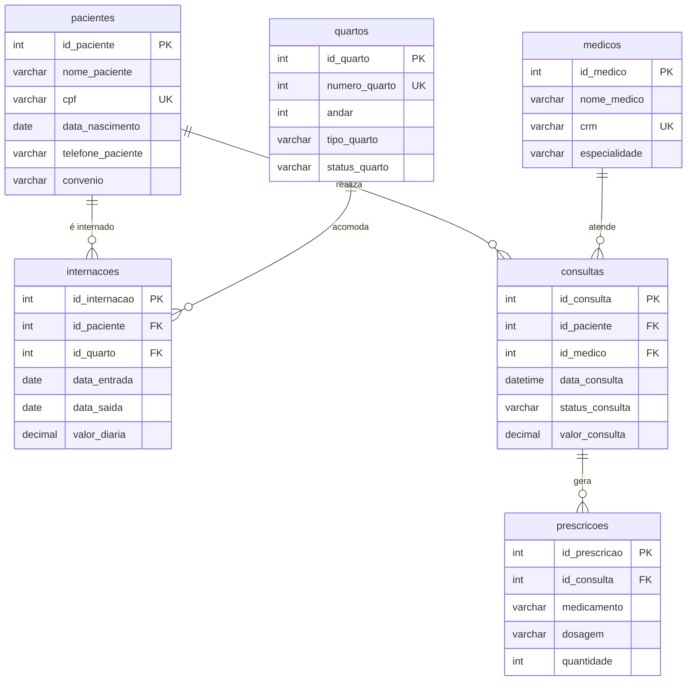

# 🏥 VIDA & SAÚDE

### Banco de Dados para um Sistema de Gestão Hospitalar
**Script único: DDL (criação) + DQL (15 consultas)** *Planejar, criar e consultar um banco de dados relacional para um hospital.*

> *Vida & Saúde — Pacientes cuidados, dados conectados.*

---

## 📑 Sumário

1. [Sobre o projeto](#-1-sobre-o-projeto)
2. [Modelo de dados](#-2-modelo-de-dados)
3. [Instruções DDL — Criar banco de dados e tabelas](#-3-instruções-ddl--criar-banco-de-dados-e-tabelas)
4. [Instruções DQL — 15 consultas](#-4-instruções-dql--15-consultas)
5. [Conclusão](#-5-conclusão)

---

## 🩺 1. Sobre o projeto

O **Vida & Saúde** é um banco de dados relacional para um sistema **fictício** de gestão hospitalar. Ele organiza:

| 👤 Pessoas | | 📋 Atendimento |
|-----------|--------------------|----------------|
| Pacientes |  | Consultas     |
| Médicos   | | Internações    |
|           | | Prescrições    |

Todo o projeto está em um único arquivo: **`hospital_db_script.sql`**, dividido em duas partes:

| Parte | Conteúdo |
|-------|----------|
| **DDL** | Criação do banco `hospital_db` e das 6 tabelas, com chaves e relacionamentos |
| **DQL** | 15 consultas que usam `JOIN`, filtros, ordenação e funções de agregação |

> ℹ️ **Estado atual do script:** ele contém a **estrutura** das tabelas e as consultas. Ainda **não há registros inseridos**, então as consultas retornam vazio (ou `NULL` nas agregações) até que você popule o banco com dados de teste.

---

## 🗺️ 2. Modelo de dados



---

## 🏗️ 3. Instruções DDL — Criar banco de dados e tabelas

O **DDL** (*Data Definition Language*) cria o banco, as tabelas e os relacionamentos entre elas.

### 3.1 · Criar o banco de dados

```sql
CREATE DATABASE hospital_db;
USE hospital_db;
```

> ⚠️ O `DROP DATABASE IF EXISTS` **apaga** um banco `hospital_db` já existente. Use com cuidado.

### 3.2 · Criar as tabelas

**`pacientes`** — cadastro dos pacientes

```sql
CREATE TABLE pacientes (
    id_paciente       INT AUTO_INCREMENT PRIMARY KEY,
    nome_paciente     VARCHAR(100) NOT NULL,
    cpf               VARCHAR(14)  NOT NULL UNIQUE,
    data_nascimento   DATE         NOT NULL,
    telefone_paciente VARCHAR(20),
    convenio          VARCHAR(50)
);
```

**`medicos`** — cadastro dos médicos

```sql
CREATE TABLE medicos (
    id_medico     INT AUTO_INCREMENT PRIMARY KEY,
    nome_medico   VARCHAR(100) NOT NULL,
    crm           VARCHAR(20)  NOT NULL UNIQUE,
    especialidade VARCHAR(60)  NOT NULL
);
```

**`quartos`** — quartos do hospital

```sql
CREATE TABLE quartos (
    id_quarto     INT AUTO_INCREMENT PRIMARY KEY,
    numero_quarto INT         NOT NULL UNIQUE,
    andar         INT         NOT NULL,
    tipo_quarto   VARCHAR(30) NOT NULL,
    status_quarto VARCHAR(20) NOT NULL
);
```

**`internacoes`** — liga pacientes a quartos

```sql
CREATE TABLE internacoes (
    id_internacao INT AUTO_INCREMENT PRIMARY KEY,
    id_paciente   INT           NOT NULL,
    id_quarto     INT           NOT NULL,
    data_entrada  DATE          NOT NULL,
    data_saida    DATE,
    valor_diaria  DECIMAL(10,2) NOT NULL,
    FOREIGN KEY (id_paciente) REFERENCES pacientes (id_paciente),
    FOREIGN KEY (id_quarto)   REFERENCES quartos (id_quarto)
);
```

**`consultas`** — liga pacientes a médicos

```sql
CREATE TABLE consultas (
    id_consulta     INT AUTO_INCREMENT PRIMARY KEY,
    id_paciente     INT           NOT NULL,
    id_medico       INT           NOT NULL,
    data_consulta   DATETIME      NOT NULL,
    status_consulta VARCHAR(20)   NOT NULL,
    valor_consulta  DECIMAL(10,2) NOT NULL,
    FOREIGN KEY (id_paciente) REFERENCES pacientes (id_paciente),
    FOREIGN KEY (id_medico)   REFERENCES medicos (id_medico),
    UNIQUE (id_medico, data_consulta)
);
```

**`prescricoes`** — medicamentos receitados em cada consulta

```sql
CREATE TABLE prescricoes (
    id_prescricao INT AUTO_INCREMENT PRIMARY KEY,
    id_consulta   INT          NOT NULL,
    medicamento   VARCHAR(100) NOT NULL,
    dosagem       VARCHAR(100) NOT NULL,
    quantidade    INT          NOT NULL,
    FOREIGN KEY (id_consulta) REFERENCES consultas (id_consulta)
);
```

### 3.3 · Relacionamentos e regras de integridade

**Chaves estrangeiras**

| Tabela filha  | Coluna        | Tabela pai  | Relação |
|---------------|---------------|-------------|---------|
| `internacoes` | `id_paciente` | `pacientes` | 1:N — um paciente pode ter várias internações |
| `internacoes` | `id_quarto`   | `quartos`   | 1:N — um quarto pode ter várias internações |
| `consultas`   | `id_paciente` | `pacientes` | 1:N — um paciente pode ter várias consultas |
| `consultas`   | `id_medico`   | `medicos`   | 1:N — um médico pode atender várias consultas |
| `prescricoes` | `id_consulta` | `consultas` | 1:N — uma consulta pode gerar várias prescrições |

**Outras restrições**

| Tipo             | Onde                                  | Regra |
|------------------|---------------------------------------|-------|
| `PRIMARY KEY`    | `id_*` de todas as tabelas            | Identificador único, gerado com `AUTO_INCREMENT` |
| `UNIQUE`         | `pacientes.cpf`                       | Não existem dois pacientes com o mesmo CPF |
| `UNIQUE`         | `medicos.crm`                         | Não existem dois médicos com o mesmo CRM |
| `UNIQUE`         | `quartos.numero_quarto`               | Não existem dois quartos com o mesmo número |
| `UNIQUE`         | `consultas (id_medico, data_consulta)`| Um médico não atende duas consultas no mesmo horário |
| `NOT NULL`       | Campos obrigatórios                   | `data_saida` e `telefone_paciente` / `convenio` são opcionais (internação em andamento, paciente sem convênio) |

---

## 🔎 4. Instruções DQL — 15 consultas

O **DQL** (*Data Query Language*) reúne as 15 consultas do sistema, organizadas por área do hospital.

### 💊 Prescrições e farmácia

**4.1 · Farmácia: paciente, médico, data, medicamento e quantidade**

*Junta quatro tabelas com `JOIN` para mostrar tudo que foi prescrito.*

```sql
SELECT p.nome_paciente, m.nome_medico, c.data_consulta, pr.medicamento, pr.quantidade
FROM prescricoes pr
JOIN consultas c ON pr.id_consulta = c.id_consulta
JOIN pacientes p ON c.id_paciente = p.id_paciente
JOIN medicos m ON c.id_medico = m.id_medico;
```

**4.2 · Prescrições: médico, especialidade, paciente e remédio**

```sql
SELECT m.nome_medico, m.especialidade, p.nome_paciente, pr.medicamento
FROM prescricoes pr
JOIN consultas c ON pr.id_consulta = c.id_consulta
JOIN medicos m ON c.id_medico = m.id_medico
JOIN pacientes p ON c.id_paciente = p.id_paciente;
```

### 🛏️ Internações e quartos

**4.3 · Auditoria: paciente, quarto, andar, data de entrada e diária**

```sql
SELECT p.nome_paciente, q.numero_quarto, q.andar, i.data_entrada, i.valor_diaria
FROM internacoes i
JOIN pacientes p ON i.id_paciente = p.id_paciente
JOIN quartos q ON i.id_quarto = q.id_quarto;
```

**4.4 · Paciente, quarto e diária (da menor para a maior)**

*`ORDER BY` crescente (padrão).*

```sql
SELECT p.nome_paciente, q.numero_quarto, i.valor_diaria
FROM internacoes i
JOIN pacientes p ON i.id_paciente = p.id_paciente
JOIN quartos q ON i.id_quarto = q.id_quarto
ORDER BY i.valor_diaria;
```

**4.5 · Internações no 1º semestre de 2026**

*`BETWEEN` considera os dois limites da data.*

```sql
SELECT p.nome_paciente, q.numero_quarto, i.data_entrada
FROM internacoes i
JOIN pacientes p ON i.id_paciente = p.id_paciente
JOIN quartos q ON i.id_quarto = q.id_quarto
WHERE i.data_entrada BETWEEN '2026-01-01' AND '2026-06-30';
```

**4.6 · Total das diárias por andar (pacientes "Oliveira")**

*`LIKE` + `SUM` + `GROUP BY`.*

```sql
SELECT q.andar, SUM(i.valor_diaria) AS total_diarias
FROM internacoes i
JOIN pacientes p ON i.id_paciente = p.id_paciente
JOIN quartos q ON i.id_quarto = q.id_quarto
WHERE p.nome_paciente LIKE '%Oliveira%'
GROUP BY q.andar
ORDER BY q.andar;
```

### 🩻 Consultas

**4.7 · Recepção: todos os pacientes, convênio, médicos e especialidades**

*O `LEFT JOIN` mantém pacientes que ainda não tiveram nenhuma consulta.*

```sql
SELECT p.nome_paciente, p.convenio, m.nome_medico, m.especialidade
FROM pacientes p
LEFT JOIN consultas c ON p.id_paciente = c.id_paciente
LEFT JOIN medicos m ON c.id_medico = m.id_medico;
```

**4.8 · Pacientes internados que tiveram consulta (sem duplicidade)**

*`DISTINCT` evita repetir o mesmo paciente.*

```sql
SELECT DISTINCT p.nome_paciente, q.numero_quarto, m.nome_medico, c.data_consulta
FROM pacientes p
JOIN internacoes i ON p.id_paciente = i.id_paciente
JOIN quartos q ON i.id_quarto = q.id_quarto
JOIN consultas c ON p.id_paciente = c.id_paciente
JOIN medicos m ON c.id_medico = m.id_medico;
```

**4.9 · Consultas, das mais recentes para as mais antigas**

```sql
SELECT p.nome_paciente, m.nome_medico, c.data_consulta
FROM consultas c
JOIN pacientes p ON c.id_paciente = p.id_paciente
JOIN medicos m ON c.id_medico = m.id_medico
ORDER BY c.data_consulta DESC;
```

**4.10 · Consultas de pacientes "Silva"**

```sql
SELECT p.nome_paciente, m.nome_medico, c.data_consulta
FROM consultas c
JOIN pacientes p ON c.id_paciente = p.id_paciente
JOIN medicos m ON c.id_medico = m.id_medico
WHERE p.nome_paciente LIKE '%Silva%';
```

**4.11 · Consultas de médicos de Cardiologia**

```sql
SELECT p.nome_paciente, m.nome_medico, m.especialidade
FROM consultas c
JOIN pacientes p ON c.id_paciente = p.id_paciente
JOIN medicos m ON c.id_medico = m.id_medico
WHERE m.especialidade LIKE '%Cardio%';
```

### 💰 Financeiro

**4.12 · Valor médio das consultas**

```sql
SELECT AVG(valor_consulta) AS valor_medio
FROM consultas;
```

**4.13 · Total arrecadado com consultas**

```sql
SELECT SUM(valor_consulta) AS total_arrecadado
FROM consultas;
```

**4.14 · Total gasto em consultas por paciente Unimed (do maior para o menor)**

```sql
SELECT p.nome_paciente, p.convenio, SUM(c.valor_consulta) AS total_gasto
FROM consultas c
JOIN pacientes p ON c.id_paciente = p.id_paciente
WHERE p.convenio LIKE '%Unimed%'
GROUP BY p.nome_paciente, p.convenio
ORDER BY total_gasto DESC;
```

**4.15 · Faturamento por especialidade cirúrgica (do maior para o menor)**

```sql
SELECT m.especialidade, SUM(c.valor_consulta) AS total_arrecadado
FROM consultas c
JOIN medicos m ON c.id_medico = m.id_medico
WHERE m.especialidade LIKE '%Cirurgia%'
GROUP BY m.especialidade
ORDER BY total_arrecadado DESC;
```

**Recursos SQL utilizados:** `SELECT` · `DISTINCT` · `WHERE` · `LIKE` · `BETWEEN` · `JOIN` · `LEFT JOIN` · `GROUP BY` · `ORDER BY` · `AVG` · `SUM`.

---


## 🏁 5. Conclusão

O **Vida & Saúde** mostra como um banco relacional organiza a rotina de um hospital. Com **6 tabelas**, o modelo cobre pacientes, médicos, quartos, internações, consultas e prescrições.

Chaves primárias e estrangeiras, restrições `UNIQUE` e `NOT NULL` garantem a consistência dos dados, e as **15 consultas** demonstram o uso de `JOIN`, filtros, ordenação e agregações para responder às necessidades de áreas como farmácia, recepção, auditoria e financeiro.

---

**🏥 Vida & Saúde — Pacientes cuidados, dados conectados.**
